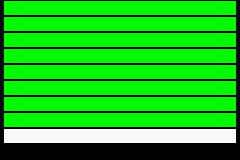

# GXA: external audio for GBA ROMs

GXA lets a Game Boy Advance ROM play audio stored outside the ROM: voiced
dialogue, arranged soundtracks, high-quality effects. It is the GBA's
counterpart to the SNES's MSU-1.

A ROM writes a few registers. A GXA emulator plays the tracks from a `.gxa`
pack that the player adds. Everywhere else, the ROM runs as before, silently.

- **The standard:** [SPEC.md](SPEC.md).
- **First implementation:** GoGBA, through its libretro-mgba core.



## For ROM and hack authors

1. Check for GXA once (SPEC.md §2). Without it, keep the game's own behavior.
2. Play a track:

   ```c
   #define GXA ((volatile uint16_t *) 0x04FFFA00)
   GXA[8] = 42;   // channel 0 TRACK
   GXA[9] = 1;    // channel 0 CTRL: play
   // GXA[12] & 4: ended
   ```

3. Build the pack: write a `manifest.json` (SPEC.md §4) next to your WAV, FLAC
   or Ogg files, then run:

   ```sh
   pip install -r tools/requirements.txt
   python3 tools/gxa_pack.py my-pack-dir my-game.gxa
   python3 tools/gxa_info.py my-game.gxa
   ```

Ship the pack beside your ROM or patch. Players load it in their emulator; by
convention `my-game.gba` picks up `my-game.gxa` from the same folder.

## For emulator authors

- **Reference implementation (C):** GoGBA's libretro-mgba core. In that tree:
  `src/gba/gxa.c` (registers, channels, rendering, state) and
  `src/gba/gxa-pack.c` (pack reading and ROM matching), with the hooks in
  `src/gba/io.c`, `src/gba/audio.c` and `src/gba/core.c`; the libretro glue in
  `src/platform/libretro/libretro.c` and `libretro_gxa.h`.
- **Spec check:** `python3 tools/check_spec.py <mgba-tree>` compares this
  spec's register table with an implementation's constants.
- **Conformance:** run `test-rom/gxa-conformance.gba` with
  `test-rom/gxa-conformance.gxa`. Every row must turn green.

## Licences

- This specification text: CC BY 4.0 ([LICENSE-SPEC](LICENSE-SPEC)).
- The tools and the conformance ROM: MIT
  ([LICENSE-TOOLS](LICENSE-TOOLS)).
- The reference implementation follows mGBA: MPL 2.0.
