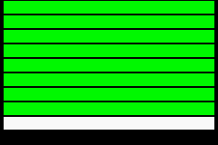

[English](README.md)

# GXA：GBA ROM 外挂音频规范

由 [GoGBA](https://gogba.xyz/) 首创，向所有模拟器和 ROM 开放。

GXA 让 GBA ROM 播放存放在 ROM 之外的音频：剧情配音、重编曲、高音质音效。它在 GBA 上的地位相当于 SNES 的 MSU-1。
ROM 只需写几个寄存器，支持 GXA 的模拟器就会从 ROM 旁边的 `.gxa` pack 里播放对应曲目。在真机和其他模拟器上，ROM
照常运行，用的还是原来的声音。

规范正文见 [SPEC.md](SPEC.md)（GXA 1.0，英文为准）。

## 效果

梦幻模拟战 II（Langrisser II）配音版在 GoGBA 上运行，剧情全程由 GXA pack 提供配音。

## 从哪里开始

| 你是 | 阅读 |
|---|---|
| 只有 ROM，要做 hack | [二进制 hook 指南](docs/guides/binary-m4a-hook.zh-CN.md)（m4a/Sappy 引擎的游戏），然后看[制作 pack](docs/guides/making-a-pack.zh-CN.md) |
| 做 homebrew，或基于 decomp（C 源码）做 hack | [C 源码指南](docs/guides/c-source.zh-CN.md)和 [include/gxa.h](include/gxa.h)，然后看[制作 pack](docs/guides/making-a-pack.zh-CN.md) |
| 写模拟器 | [SPEC.md](SPEC.md)、[参考实现](#给模拟器作者)和 [conformance ROM](test-rom) |
| 玩游戏 | 把 `game.gxa` 放在 `game.gba` 旁边，用下表里的模拟器打开 ROM |

## 用 AI 编程助手？

让它读 [AGENTS.md](AGENTS.md)。里面写了该读哪些文件、保证 ROM 在任何模拟器上都安全的规则，以及怎么验证结果。

## 支持的模拟器

| 模拟器 | GXA | Conformance |
|---|---|---|
| [GoGBA](https://gogba.xyz/)（iOS、Android），核心：[libretro-mgba](https://github.com/hamberluo/libretro-mgba) | 1.0 | 全部通过 |



你的模拟器实现了 GXA？请提一个 [emulator support issue](https://github.com/hamberluo/gba-gxa/issues/new?template=emulator-support.yml)，
附上 conformance ROM 的运行截图。

使用 GXA 的作品列在 [SHOWCASE.md](SHOWCASE.md)。

## 给模拟器作者

- **规范**：[SPEC.md](SPEC.md)。寄存器在 `0x04FFFA00`，先握手，共 4 个通道，pack 是 Ogg Vorbis 的 zip 包。
- **参考实现（C，MPL 2.0）**：[hamberluo/libretro-mgba](https://github.com/hamberluo/libretro-mgba)。
  `src/gba/gxa.c`（寄存器、通道、渲染、存档状态）、`src/gba/gxa-pack.c`（读取 pack、匹配 ROM），挂接点在
  `src/gba/io.c`、`src/gba/audio.c`、`src/gba/core.c`，libretro 接口在 `src/platform/libretro/libretro.c` 和 `libretro_gxa.h`。
- **Conformance 测试**：运行 [test-rom/gxa-conformance.gba](test-rom/gxa-conformance.gba)，旁边放 `test-rom/gxa-conformance.gxa`。
  每一行都必须变绿；自动化测试读取结果区（SPEC.md §6）。
- **规范核对**：`python3 tools/check_spec.py <你的源码目录>` 会把 SPEC.md 的寄存器表和基于 mGBA 的源码里的常量对比。

## 工具

```sh
pip install -r tools/requirements.txt
python3 tools/gxa_pack.py my-pack-dir my-game.gxa   # 打包
python3 tools/gxa_info.py my-game.gxa               # 查看 pack 内容
python3 tools/m4a_locate.py my-game.gba             # 定位要 hook 的 m4a 歌曲函数
python3 tools/gba_header.py my-game.gba             # 打补丁后修正文件头校验和
```

## 版权

本仓库不包含任何游戏音频或 ROM。pack 作者需自行确保有权分发其中的音频。

## 参与贡献和许可证

见 [CONTRIBUTING.md](CONTRIBUTING.md)。规范的修改从提 issue 开始。

- 规范文本：CC BY 4.0（[LICENSE-SPEC](LICENSE-SPEC)）。
- 工具、头文件、示例和 conformance ROM：MIT（[LICENSE-TOOLS](LICENSE-TOOLS)）。
- 参考实现沿用 mGBA 的许可：MPL 2.0。
